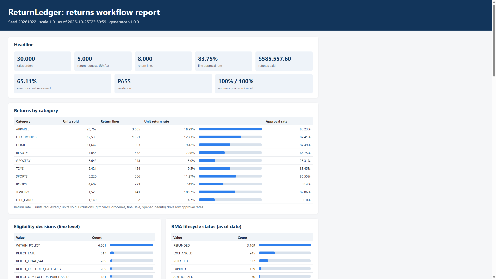
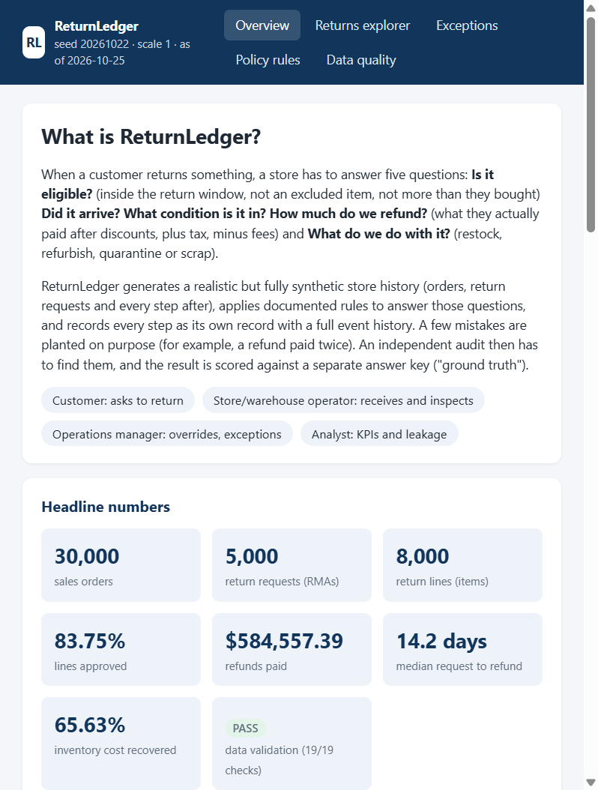
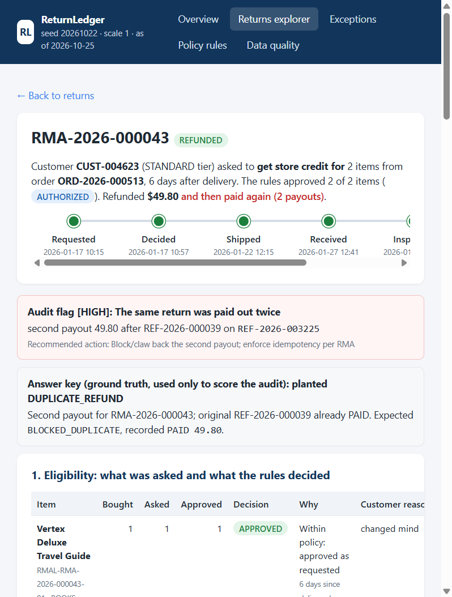
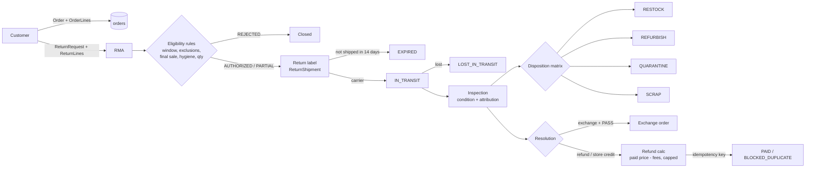

# ReturnLedger

**A traceable, rule-driven returns (RMA) workflow with a reproducible synthetic dataset, an independent audit and measurable results.**

ReturnLedger models what happens after a customer clicks "Return item": the request is checked against the
return policy, authorized (fully, partially or not at all), shipped back, inspected in the warehouse, refunded
(or exchanged), and the units are restocked, refurbished, quarantined or scrapped. Every step is a separate record
that points to its parent, and every state change is appended to an event history, so any refund can be traced
back to the exact order line, policy version and inspection that justified it.



## Submission contents

Everything for review is in this repository. Start here, then follow the links.

| What | Where |
| --- | --- |
| Setup and run instructions | [Setup and run](#setup-and-run) (below) |
| How the core functionality was verified | [docs/VERIFICATION.md](docs/VERIFICATION.md), summarised in [How it was verified](#how-it-was-verified) |
| Source code | [`returnledger/`](returnledger) (Python package and web UI), [`tests/`](tests) |
| Prompt history (every prompt given to the AI) | [prompts/PROMPT_HISTORY.md](prompts/PROMPT_HISTORY.md) |
| AI usage disclosure | [docs/AI_USAGE.md](docs/AI_USAGE.md) |
| Design decisions and business rules | [docs/DESIGN.md](docs/DESIGN.md) |
| Assumptions and deviations from the brief | [docs/DESIGN.md, section 9](docs/DESIGN.md#9-assumptions-and-deviations-from-the-brief) |
| Data dictionary and SQL schema | [docs/DATA_DICTIONARY.md](docs/DATA_DICTIONARY.md), [docs/schema.sql](docs/schema.sql) |
| Generated datasets (synthetic) | [`data/starter/`](data/starter) (all formats), [`data/full/`](data/full) (CSV, ground truth, reports) |
| Ground truth (answer key, kept apart from inputs) | `data/<scale>/ground_truth/` |
| Validation, evaluation, reproducibility and robustness reports | `data/<scale>/reports/` |
| Screenshots | [`docs/images/`](docs/images) |
| Environment needs, limitations, security notes | [Environment](#environment), [Limitations](#limitations-and-next-steps), [Security, privacy and configuration](#security-privacy-and-configuration) |

## What this project does

1. **Generates a realistic synthetic retail dataset** from one fixed seed (`20261022`): 12,000 customers,
   30,000 orders, 5,000 return requests and exactly 8,000 return lines, plus shipments, inspections, refunds,
   dispositions, inventory movements and about 140,000 lifecycle events.
2. **Applies documented business rules** (a policy engine in `returnledger/policy.py`) to decide eligibility,
   refund amounts and disposition. These outcomes are *calculated* from the source records, not randomly
   assigned.
3. **Injects five kinds of labelled process failures** (40 each at full scale) and writes them to a separate
   ground-truth file that never appears in the input tables:
   - return quantity exceeds purchased quantity
   - refund exceeds paid amount
   - restock before inspection
   - return after the policy window without an override
   - duplicate refund
4. **Validates the dataset**: 19 checks covering primary keys, foreign keys (including a database-enforced
   check in SQLite), enums, ID formats, date ordering, arithmetic reconciliation, quantity flow, lifecycle
   transitions and duplicates. A check fails only if it finds a violation that isn't a labelled anomaly.
5. **Audits the data independently**: `audit.py` reads only the exported CSVs, re-derives what the policy says
   should have happened and raises classified findings. These are scored against ground truth (precision and
   recall).
6. **Reports KPIs**: return rates by category, approval rate, refund economics, cycle times, disposition mix,
   inventory recovery, scenario coverage and leakage. Output is JSON plus a self-contained HTML report.
7. **Proves reproducibility**: the generator runs twice with the same seed and compares SHA-256 checksums of
   every exported file.

## Results (full dataset, seed 20261022)

| Measure | Result |
|---|---|
| Validation | **PASS**: 19/19 checks, 0 unlabelled violations |
| Anomaly detection vs ground truth | 200/200 found, 0 false positives (precision 100%, recall 100%) |
| Recorded decisions that match policy (clean lines) | 100% of 7,767 lines |
| Line approval rate | 83.75% (rejections: late 517, final sale 285, excluded category 205, quantity 181, hygiene 110) |
| Unit return rate | 12.5% overall; apparel 19.0%, gift cards 4.7% (never approved) |
| Refunds paid | $584,557.39 across 3,115 refunds (7.1% of order value) |
| Request to refund | median 14.2 days, 90th percentile 20.5 days |
| Inventory cost recovered | 65.6% (restock 5,325 units, refurbish 718, quarantine 656, scrap 1,235) |
| Duplicate payout attempts blocked by idempotency | 127 attempts ($21,379.75) |
| Leakage caused by the injected anomalies | $9,608.70 (all flagged by the audit) |
| Reproducibility | 39 files byte-identical across two runs (starter and full) |
| Robustness | 5 seeds at full scale and 20 at starter scale, each clean and with anomalies: 0 unlabelled violations |

Full details: [`data/full/reports/validation_summary.md`](data/full/reports/validation_summary.md),
[`evaluation.json`](data/full/reports/evaluation.json), [`metrics.json`](data/full/reports/metrics.json),
[`reproducibility.md`](data/full/reports/reproducibility.md), [`robustness.md`](data/full/reports/robustness.md),
and `report.html` (open it in a browser).

## Setup and run

### Environment

| Need | Details |
| --- | --- |
| Python | **3.10 or newer** (tested with 3.13). Check with `python --version`; on macOS/Linux it may be `python3`. |
| Packages | None. Only the standard library is used, so there is nothing to `pip install` and no virtual environment is needed. `requirements.txt` only contains a comment saying so. |
| Operating system | Windows, macOS or Linux. Developed and verified on Windows 11. |
| Disk | About 60 MB for the clone. The full run writes about 165 MB more (JSON, SQL and SQLite exports, which are git-ignored). |
| Memory | The full-scale run peaked at about 500 MB, so allow 1 GB free. The starter scale needs very little. |
| Network | Only for `git clone`. Generation, tests and the web UI run fully offline. |
| Ports | The web UI uses `127.0.0.1:8000` by default (change with `--port`). |
| Configuration | None. No accounts, API keys, environment variables or `.env` file. All parameters (seed, volumes, policies) are in `returnledger/config.py`. |
| Optional | VS Code with the Python extension, for the one-click run configurations below. |

### Quick start (any terminal)

```bash
git clone https://github.com/vamsi-droid-code/ReturnLedger.git
cd ReturnLedger
python -m unittest discover -s tests          # 32 tests, about 3 s
python -m returnledger run --scale starter    # small dataset end to end, a few seconds
python -m returnledger serve --scale full     # open http://127.0.0.1:8000 (Ctrl+C to stop)
```

The committed data and reports are already in the repository, so `serve` works straight after cloning. Running
`run` regenerates them, and the result is byte-identical to what is committed.

### In VS Code

1. Clone the repository and open the folder in VS Code (**File > Open Folder**).
2. Install the recommended **Python** extension when prompted.
3. Open **Run and Debug** (Ctrl+Shift+D), choose a configuration and press **F5**:
   - `0. Web UI - full dataset`: opens the explorer in your browser (see [Web UI](#web-ui) below)
   - `1. Run pipeline - starter`: generates 3,000 orders, then validates, audits and reports (a few seconds)
   - `2. Run pipeline - full`: the full 30,000 order dataset (about 30-60 s)
   - `3. Reproducibility check`
   - `4. Explain one RMA end to end`: prompts for an RMA id and prints its whole trace
   - `5. Run tests`
4. Or use **Terminal > Run Task...** for the same commands, plus `open starter report` / `open full report`.
5. The Testing panel (beaker icon) also discovers the 32 unit tests.

### Command line equivalents

```bash
python -m returnledger serve --scale full           # web UI at http://127.0.0.1:8000 (Ctrl+C to stop)
python -m returnledger run --scale starter          # generate + validate + audit + evaluate + report
python -m returnledger run --scale full             # 30k orders / 5k RMAs / 8k return lines
python -m returnledger run --scale 0.25 --seed 7    # any scale or seed, same generator
python -m returnledger reproduce --scale full       # generate twice, compare checksums
python -m returnledger robustness --scale full      # 5 seeds x (clean, with anomalies): 0 unlabelled violations
python -m returnledger explain --scale full --rma RMA-2026-000043
python -m returnledger docs                         # regenerate docs/DATA_DICTIONARY.md and docs/schema.sql
python -m unittest discover -s tests -v
```

`run` exits with code 1 if validation fails, so it can be used in CI.

## Web UI

`python -m returnledger serve --scale full` starts a small local web app (standard library only) and opens it in
the browser. It is read-only: it shows the exported files and reports, and computes nothing new. Use
`--scale starter` for the small dataset, `--port` to change the port and `--no-browser` to skip opening a tab.

| Page | What it answers |
| --- | --- |
| Overview | What the project does, headline numbers, the return funnel, example RMAs for each planted mistake |
| Returns explorer | All 5,000 RMAs, searchable and filterable by status or by audit issue |
| RMA detail | One return told as a story: eligibility per item, parcel, inspection and stock movement, refund maths, full event history, audit flags and the answer key |
| Exceptions | Every audit finding, with found / false alarm / missed per issue type |
| Policy rules | Return windows by category and date, eligibility order, refund formula, disposition matrix |
| Data quality | The 19 validation checks, reproducibility checksums, multi-seed robustness, provenance |




### What a trace looks like

`explain` follows one RMA through every table. This one is an injected duplicate refund. It also shows a
short-shipped line: 2 units were approved, 1 was received, so only 1 was refunded.

```
RMA-2026-000043  status=REFUNDED  resolution=STORE_CREDIT  channel=APP
  lines:
    RMAL-RMA-2026-000043-01 BOOKS       bought=1 asked=1 reason=CHANGED_MIND paid=$24.37
      -> APPROVED qty=1 reason=WITHIN_POLICY days=6/30 policy=POL-BOOKS-V1
    RMAL-RMA-2026-000043-02 ELECTRONICS bought=2 asked=2 reason=WRONG_ITEM paid=$50.86
      -> APPROVED qty=2 reason=WITHIN_POLICY days=6/30 policy=POL-ELECTRONICS-V1
  inspection INS-2026-000069 RMAL-RMA-2026-000043-01 recv=1 UNOPENED/NONE PASS -> RESTOCK
  inspection INS-2026-000070 RMAL-RMA-2026-000043-02 recv=1 UNOPENED/NONE FAIL -> RESTOCK
  refund REF-2026-000039 PAID key=RMA-2026-000043:REFUND:1 ... = $49.80
  refund REF-2026-003225 PAID key=RMA-2026-000043:REFUND:2 ... = $49.80
  event history: ORDER PLACED -> ... -> RETURN_REQUEST REFUNDED -> second REFUND PAID
  audit findings:
    [HIGH] DUPLICATE_REFUND REF-2026-003225: second payout 49.80 after REF-2026-000039
```

## How it was verified

Each check runs the code and compares its output with something independent. Full commands, outputs and
caveats are in [docs/VERIFICATION.md](docs/VERIFICATION.md).

| Check | Command | Result |
| --- | --- | --- |
| Rules, pipeline and web UI tests | `python -m unittest discover -s tests -v` | 32 tests pass |
| Validation (19 checks) | `python -m returnledger run --scale full` | PASS, 0 unlabelled violations |
| Audit vs separate answer key | same run | 200/200 planted mistakes found, 0 false alarms |
| Recorded decisions vs policy | same run | 100% of clean lines match |
| Reproducibility | `python -m returnledger reproduce --scale full` | 39 files byte-identical across two runs |
| Committed data is genuine output | `run` both scales, then `git status` | no changes |
| Robustness | `python -m returnledger robustness --scale full` | 5 seeds, clean and with anomalies, 0 unlabelled violations |
| Manual | `explain --rma RMA-2026-000043`, web UI, HTML report | refund maths checked by hand; pages checked visually |

## Workflow



## Key business rules (summary)

Full detail is in [docs/DESIGN.md](docs/DESIGN.md).

- **Return window** = category policy window (effective-dated by order date; apparel changed from 60 to 45 days on
  2026-07-01) + loyalty extension (GOLD +15, PLATINUM +30). A request on exactly the last day is on time; one day
  later it is late unless an ops manager recorded an override.
- **Exclusions**: gift cards are never returnable; groceries only for merchant-fault reasons; final-sale
  (clearance) lines and opened beauty items only for merchant-fault reasons. Overrides never bypass exclusions.
- **Quantity**: approved = min(requested, purchased minus quantity approved on earlier RMAs). This covers partial
  and repeat returns.
- **Refund** = returned share of the *paid* net amount (after line promotion and the pro-rata share of the order
  coupon) + the matching share of tax, minus a restocking fee (opened, non-fault electronics 15% / sports 10%),
  minus a 50% damage deduction for customer damage, and zero for a non-original item. The result is capped so the
  cumulative refund never exceeds what was paid. A $6.99 label fee applies to customer-reason mail returns, and
  original shipping is refunded once when the merchant is at fault.
- **Disposition** controls inventory movement: unopened goes to restock, opened electronics to refurbish, damaged
  goods to refurbish (if electronics or at least $100) or scrap, defective electronics/toys/home items to
  quarantine (vendor/safety), and non-original items to quarantine (fraud). Movement only happens after
  inspection.
- **Duplicate payouts**: one idempotency key per RMA; retries with the same key are recorded as
  `BLOCKED_DUPLICATE` with $0 paid.

## Repository layout

```
returnledger/            Python package (standard library only)
  config.py              seed, volumes, policy table, distributions
  schema.py              every table/field/enum/FK/lifecycle: single source of truth
  policy.py              business rules (pure functions)
  generator.py           seeded generator: master -> transactions -> events
  anomalies.py           labelled edge-case injection -> ground truth
  storage.py             CSV / JSON / SQL / SQLite export, loader, manifest
  validate.py            19 validation checks
  audit.py               independent exception detector
  evaluate.py            findings and decisions vs ground truth
  metrics.py, report.py  KPIs, HTML report, data dictionary
  webapp.py, web/        read-only web UI (python -m returnledger serve)
  __main__.py            CLI
tests/                   unit tests (rules) + end-to-end pipeline tests
data/starter/            3k-order dataset: csv/, json/, sql/, ground_truth/, reports/, manifest.json
data/full/               30k-order dataset: csv/, ground_truth/, reports/, manifest.json
docs/                    DATA_DICTIONARY.md, DESIGN.md, VERIFICATION.md, schema.sql, AI_USAGE.md, images/
prompts/PROMPT_HISTORY.md  every prompt given to the AI tool
```

`data/full/json`, `data/full/sql` and the `.db` files (about 165 MB) aren't committed. Running
`python -m returnledger run --scale full` regenerates them byte-for-byte. The checksums for every file are in
`data/full/manifest.json`.

## Data provenance and lawful use

No external data is used. Every record comes from the seeded generator. Customer names are random
combinations of common first and last names, emails use the reserved `example.com` domain, and tax rates are
illustrative. See `provenance` in each `manifest.json`. Code and data are released under the MIT License.

## Security, privacy and configuration

- **No secrets or credentials.** The project needs no accounts, API keys, tokens or passwords, and the repository
  contains none. There is no `.env` file because there is nothing to configure outside the code.
- **No personal or real data.** Every customer, order and refund is synthetic, emails are
  `userNNNNNN@example.com` (a reserved domain), and no real person, company or payment data is included.
- **Local configuration only.** Parameters live in `returnledger/config.py` and are passed on the command line
  (`--scale`, `--seed`, `--port`).
- **Local-only web UI.** The server binds to `127.0.0.1`, so it can't be reached from other machines. It is
  read-only, serves only its own `web/` folder and the API (other paths return 404), and has no login because it
  holds nothing private.
- **No proprietary code.** All code was written for this project and is MIT-licensed. There are no third-party
  dependencies.

## Limitations and next steps

- The audit uses the same policy functions as the generator, so 100% precision and recall shows that the data
  and the rules are consistent. It isn't a benchmark of a learned model. A natural next step is to train or
  test a detector that cannot see the rules, using ground truth as labels.
- The model is simplified in places: one warehouse per RMA, exchanges are like-for-like at $0, no partial
  refunds for lost parcels (lost parcels stay unrefunded pending a carrier claim), and no multi-currency or
  multi-jurisdiction tax rules.
- Ground truth labels each anomaly at its primary entity. Secondary effects (for example, phantom inventory
  from an over-approved quantity) are documented but not labelled separately.
- The web UI is a local, read-only viewer for one person. It has no login, no editing, and no multi-user or
  production deployment. It loads the whole dataset into memory at start-up (a few seconds at full scale).
- Environment: verified on Windows 11 with Python 3.13. Linux and macOS should give identical results (standard
  library only, LF line endings forced), but weren't tested directly. Python below 3.10 isn't supported.
- `data/full/json`, `data/full/sql` and the SQLite files aren't committed because of their size (about 165 MB).
  Run the full pipeline to create them.
- Next steps: write operations through an API over the SQLite database, policy versions managed as data instead
  of config, and fraud signals such as serial returners or empty-box rates.

## AI usage

This project was built with an AI coding assistant (Claude in Cursor). See
[docs/AI_USAGE.md](docs/AI_USAGE.md) for what was AI-generated and what was reviewed and verified, and
[prompts/PROMPT_HISTORY.md](prompts/PROMPT_HISTORY.md) for every prompt.
