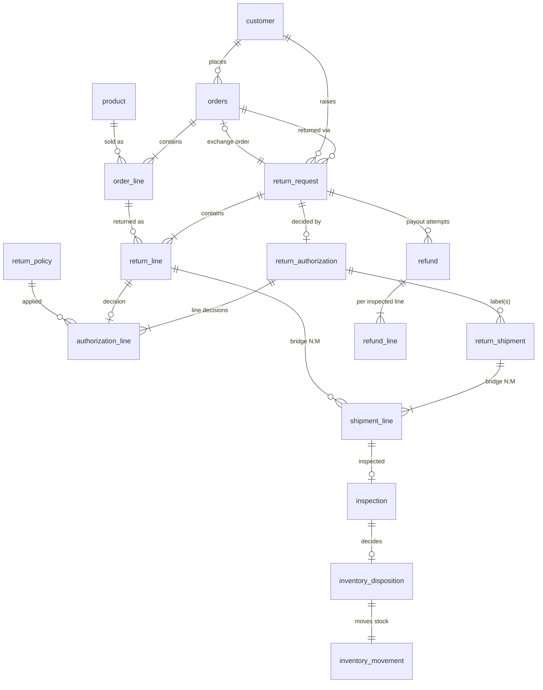

# Design, assumptions and decisions

## 1. Problem framing

Retail returns cost money in four places: paying refunds that shouldn't be paid (late, excluded, over-quantity),
paying too much (ignoring discounts, double payouts), losing inventory value (restocking damaged goods,
scrapping good ones) and losing traceability (nobody can explain a refund afterwards). The brief asks for a
working workflow that exposes decisions and exceptions, preserves history, and produces measurable outputs.

I treated it as three layers:

| Layer | Module | Question it answers |
|---|---|---|
| Rules | `policy.py` | What *should* happen for this request, inspection or refund? |
| Data | `generator.py`, `anomalies.py` | A realistic history of what *did* happen, mostly correct, with known failures |
| Controls | `validate.py`, `audit.py`, `evaluate.py`, `metrics.py` | Is the data sound? Where did reality deviate from policy? How costly was it? |

## 2. Entity model



All `status_event` rows are an append-only history for `orders`, `return_request`, `return_shipment` and
`refund`, keyed by `entity_type` + `entity_id`. Field-level details, cardinality and optionality are in
[DATA_DICTIONARY.md](DATA_DICTIONARY.md), which is generated from `schema.py`.

Key modelling decisions:

- **Authorization is split into header and lines.** The brief lists `ReturnAuthorization` as one entity, but
  decisions are made per line (one line late, another excluded), so `authorization_line` holds the decision,
  the policy version applied, days since delivery, effective window and prior approved quantity. That makes
  every decision explainable from the row alone.
- **`shipment_line` is a real bridge table.** Customers sometimes split an RMA into two parcels (211 RMAs at full
  scale), so shipments and return lines are N:M.
- **Policies are effective-dated master data** (`return_policy`) and selected by the *order date*. This
  demonstrates that a decision depends on the policy in force when the customer bought the item (apparel went
  from V1 at 60 days to V2 at 45 days on 2026-07-01).
- **History is never overwritten.** `current_status` on each entity is *derived* from the last event, and
  validation proves the two agree. Refund retries are new `refund` rows, not updates.
- **Additional reference entities** (`product`, `return_policy`, `inventory_movement`, `status_event`) were
  added because the rules need them. Category, price and cost come from product, rules from policy, and the
  instruction that "disposition controls inventory movement" needs a movement record.

## 3. ID conventions

| Entity | Format | Example |
|---|---|---|
| Order | `ORD-2026-######` | `ORD-2026-000001` (sales 1-30000 by placed time; exchange orders continue after) |
| Order line | `ORDL-2026-######-##` | `ORDL-2026-000001-01` |
| Return request | `RMA-2026-######` | `RMA-2026-000001` (chronological by request time) |
| Return line | `RMAL-<rma-id>-##` | `RMAL-RMA-2026-000001-01` |
| Authorization / line | `RA-2026-######` / `RAL-<rma-id>-##` | `RA-2026-000001`, `RAL-RMA-2026-000001-01` |
| Return shipment | `RTS-2026-######` | `RTS-2026-000001` |
| Inspection | `INS-2026-######` | |
| Refund / line | `REF-2026-######` / `REFL-<refund-id>-##` | `REF-2026-000001`, `REFL-REF-2026-000001-01` |
| Disposition / movement | `DISP-2026-######` / `IMV-2026-######` | |
| Status event | `EVT-2026-#######` | chronological by event time |
| Customer / product | `CUST-######` / `SKU-######` | |

Counters are zero-padded and allocated in a deterministic processing order, so IDs are stable for a given seed.
IDs are never reused or renumbered after anomaly injection.

## 4. Business rules

### Eligibility (per return line, `policy.decide_line`)
Rules are evaluated in a fixed precedence. The first one that fails decides the outcome:

1. Category not returnable (gift card, grocery) -> `REJECT_EXCLUDED_CATEGORY`, unless the claimed reason is
   merchant fault (defective, damaged in transit, wrong item) and the policy allows that.
2. Final-sale line -> `REJECT_FINAL_SALE` unless merchant fault.
3. Opened item where the policy forbids opened returns (beauty, for hygiene) -> `REJECT_HYGIENE_OPENED` unless
   merchant fault.
4. `days_since_delivery > policy window + loyalty extension` -> `REJECT_LATE` unless
   `late_override_flag` (manager override recorded on the request). A request on the last day is on time.
5. Remaining quantity = purchased - approved on earlier RMAs. If it is 0, `REJECT_QTY_EXCEEDS_PURCHASED`. If
   requested > remaining, approve remaining as `PARTIALLY_APPROVED / QTY_CAPPED`. Otherwise `APPROVED`.

Header status: `AUTHORIZED` (all lines fully approved), `PARTIALLY_AUTHORIZED`, or `REJECTED`.

Why this order: exclusions are legal or hygiene constraints that a manager override shouldn't bypass; the
window is a commercial rule that a manager may waive; quantity is checked last because it only matters for
returnable lines.

### Inspection
The condition grade (`UNOPENED`, `OPENED_LIKE_NEW`, `DAMAGED`, `DEFECTIVE`, `NOT_ORIGINAL_ITEM`) is drawn
conditionally on the claimed reason and the "opened" declaration. Damage attribution is derived: damage on a
`DAMAGED_IN_TRANSIT` claim is `CARRIER`, other damage is `CUSTOMER`, and defects are `MANUFACTURER`. Merchant
fault for refund purposes must be *confirmed* by inspection (a "defective" claim with no fault found is
treated as a customer return).

### Refund (`policy.refund_line`, `policy.refund_header`)
```
merchandise   = round_half_up(order_line.net_amount * refund_qty / qty)   # paid price after promo + coupon share
tax           = round_half_up(order_line.tax_amount * refund_qty / qty)
restocking    = merchandise * category fee rate      if OPENED_LIKE_NEW and not merchant fault
damage        = 50% * merchandise                    if damage attributed to CUSTOMER
cap           = max(0, raw - (net + tax - already refunded on this order line))
line_refund   = merchandise + tax - restocking - damage - cap              (0 for NOT_ORIGINAL_ITEM)
refund_amount = sum(line_refund) + shipping_refund - return_label_fee
```
- The order coupon is allocated pro-rata to non-gift-card lines and the rounding remainder goes to the largest
  line, so line allocations add up exactly to the coupon.
- Tax exempt: gift cards and groceries. Tax is per line, half-up, in integer cents.
- Label fee $6.99 applies only to `ORIGINAL_PAYMENT` refunds for customer-reason, non-store returns, and never
  more than the refund itself.
- Original shipping is refunded once per order when merchant fault is confirmed.
- Exchange requests where every inspection passes become a $0 exchange order. If any inspection fails, the
  request falls back to a refund (141 cases at full scale).

### Disposition (`policy.decide_disposition`)
| Condition | Rule |
|---|---|
| UNOPENED | RESTOCK (grocery: SCRAP) |
| OPENED_LIKE_NEW | electronics: REFURBISH; beauty/grocery: SCRAP; otherwise RESTOCK |
| DAMAGED | electronics or unit price >= $100: REFURBISH; otherwise SCRAP |
| DEFECTIVE | electronics/toys/home: QUARANTINE (vendor return, safety); otherwise SCRAP |
| NOT_ORIGINAL_ITEM | QUARANTINE (fraud review) |

Each disposition creates exactly one `inventory_movement` from `RETURNS_DOCK` to the matching location, at the
same timestamp, and only after the inspection.

### Duplicate refunds
Each RMA has one idempotency key (`<rma>:REFUND:1`). A retry with the same key (4% of payouts, simulating
gateway timeouts) is stored as `BLOCKED_DUPLICATE` with `paid_amount = 0`. The injected anomaly simulates a
bypass: a *new* key and a second `PAID` refund. Validation and audit both enforce at most one payout per RMA.

## 5. Generation pipeline and realism

Each stage uses its own RNG stream seeded with `"<seed>:<stage>"`, so changing one stage doesn't shift the
random numbers of another. Python's string seeding is deterministic and independent of hash randomization.

| Aspect | Choice |
|---|---|
| Order dates | 2026-01-01 to 2026-09-30, growth trend, weekend uplift, two promo peaks, realistic hour-of-day curve |
| Customers | Pareto-distributed order frequency (a few heavy buyers), 4 loyalty tiers, 20 states with different tax |
| Basket | 1-5 lines (45% single line), category-specific quantity, 25% line promotions, 5% clearance (final sale), 18% coupons |
| Which lines get returned | weighted by category propensity (apparel 3x, gift card 0.15x) |
| Timing | Beta-distributed days to request; 10% late (a quarter of those exactly one day late); 4% exactly on the last day |
| Repeat returns | 4.5% of RMAs are a second RMA on the same order (remaining or repeated quantity, which drives capping and rejection) |
| Reasons | category-dependent (WRONG_SIZE dominates apparel and sports) |
| Logistics | 3% labels never used (expired), 1.5% lost, 12% of multi-line RMAs split, 3% short-shipped |
| As-of date | 2026-10-25. Later events aren't created, so an in-flight pipeline remains (pending decisions, in transit, received but not inspected) |

Exact volume: line counts are distributed across requests until the total is exactly 8,000. The validation
check "Target volumes met exactly" enforces 30,000 / 5,000 / 8,000.

## 6. Anomaly injection and ground truth

The baseline is generated *correct by construction*, and then a counted set of records is corrupted:

| Issue type | Where | How |
|---|---|---|
| LATE_APPROVED_WITHOUT_OVERRIDE | before downstream generation | a `REJECT_LATE` line is flipped to `APPROVED`. Shipment, inspection and refund then follow naturally, as they would in reality |
| QTY_EXCEEDS_PURCHASED | before downstream generation | a line where the customer asked for more than purchased is approved for the full request |
| REFUND_EXCEEDS_PAID | after | a refund line is inflated above the order line's paid amount (header totals are kept arithmetically consistent, so only a comparison with the order reveals it) |
| RESTOCK_BEFORE_INSPECTION | after | a RESTOCK disposition and its movement are back-dated before the inspection |
| DUPLICATE_REFUND | after | a second PAID refund with a new idempotency key |

Design choices:
- **One anomaly per RMA**, and never on an order that has several RMAs, so an anomaly can't cascade into an
  unrelated violation elsewhere. This keeps the labels unambiguous. The first version only excluded shared
  order *lines*. A multi-seed robustness run (seeds 1, 2, 3, 42) found a case where an over-refund on one RMA
  pushed a sibling RMA's legitimate refund over the *order* total, so the exclusion was widened to whole orders.
- **Ground truth is separate** (`ground_truth/`), and a unit test asserts that no label column leaks into the
  input tables. `ground_truth_anomalies.csv` has one row per injected anomaly (entity, related ids, expected
  vs recorded value). `ground_truth_labels.csv` has the expected decision, approved quantity, reason,
  disposition and refund for **every** return line, computed by the rules before corruption.

## 7. How I know it works

1. **Unit tests** (`tests/test_policy.py`, 20 tests) pin each rule, including boundaries (day = window, day =
   window + 1, loyalty extension, effective-dated policy, exclusion beats override, rounding, refund cap).
2. **Validation** (19 checks) runs on the *exported CSVs*, not on in-memory objects, plus SQLite
   `PRAGMA foreign_key_check` on a database built with every FK declared. All violations it finds are
   labelled anomalies. With anomaly injection disabled, the checks pass with zero violations.
3. **Independent audit** re-derives eligibility, refund and disposition from raw inputs and finds exactly the
   200 injected anomalies, with zero false positives. Recorded decisions on all 7,768 clean lines match the
   ground-truth labels.
4. **Reproducibility**: two runs with the same seed give byte-identical files (`reports/reproducibility.md`). A
   different seed gives different data (unit test).
5. **Manual spot checks** using `explain` on several RMAs per anomaly type, and on boundary cases.

## 8. Trade-offs and limitations

- **Shared rule code.** The audit and the generator share `policy.py`. That's deliberate (one definition of
  the rules), but it means the audit's 100% score shows consistency, not detection skill. Ground truth is
  designed so that a rule-blind detector can be benchmarked later.
- **Pure Python, standard library only.** It's slower than pandas (about 30 s at full scale) but needs zero
  installation and keeps every calculation explicit and reviewable.
- **Integer cents with half-up rounding** everywhere avoids floating-point drift. JSON uses decimal numbers
  for convenience; CSV is the canonical format.
- **Simplifications**: a single currency (USD), illustrative state tax with no local jurisdictions, one
  disposition per inspection (no split disposition), no partial carrier claims for lost parcels, exchange
  orders always $0 like-for-like.
- **Timestamps** are naive local times (no time zone). The as-of cut-off keeps all events at or before
  2026-10-25 23:59:59.
